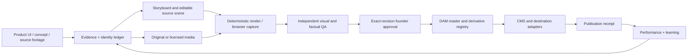

# Starlight Media Excellence — Operational Playbook v0.1

**Scope**: UI demos, videos, LinkedIn/IG carousels, screenshots, motion graphics, interactive HTML/SVG explainers, websites, DAM and CMS-linked marketing. **Owner**: CIS protocol; **execution UX**: GenCreator Studio; **quality authority**: exact artifact QA and founder approval; **release authority**: credentialed serving runtime.

This document extends `docs/VIDEO_PRODUCTION_OS.md`. It must not supersede the video stack, CIP types or existing owner boundaries without review.

## Stable activation contract

| Signal | Route | Minimum output |
| --- | --- | --- |
| New demo, explainer, carousel, animated infographic, social media conversion of live UI | `media-director` | evidence inventory, story, scene/master, real derivatives or unrendered specification, manifest |
| Existing output to inspect, polish or release | `media-release-critic` | exact output QA, three repairs at most, PASS/FAIL_FIXABLE/HOLD |
| Continue across chats/agents; audit DAM, publication or hooks | `media-continuity` | source-retrieved status, handoff, one next gate |

In ChatGPT these skills are supplied by a private, portable, skills-only plugin. In repository agents, use `AGENTS.md` and the checked-in skill source. Neither activation method grants a runtime worker or a publisher token. Future sessions must retrieve the latest authoritative facts, rather than rely on an unversioned conversational summary.

## Canonical architecture

- GitHub holds executable scenes, render recipes, skill code, tests and manifests; store versioned text/source, not large video binaries.
- Google Drive holds raw creator ingress, working video masters and portable handoff folders.
- R2 + Supabase is the **proposed** machine-serving asset graph. Establish actual buckets, tables, retention, RLS and signed URL policy before claiming deployed DAM. Use hashes to link approved masters and renditions; do not duplicate native editor state.
- Notion holds campaign strategy and the founder-facing review queue. GenCreator becomes the edition/release state authority only after an implemented, verified migration. Avoid dual approval authority.
- Cloudflare Images / Stream and website CMS consume DAM references through adapters; content publishing and publication receipts are separate.
- Starlight Plugin Forge owns portable plugin packaging and verification; official Plugin Creator holds private account releases. Neither is a production orchestrator.

## One work, independent editions

`Campaign → Work → Source/evidence → Creative direction → Canonical scene → Rendition(s) → QA → Approval → Publish attempt → Receipt → Outcome`

Required per-work identifiers: `work_id`, `brand`, `campaign_id`, `source_revision`, `scene_version`, `asset_id`, `rendition_id`, `approved_edition_hash`, `destination_account`, `idempotency_key`. Hash original bytes; revision any material change. A derivatives' copy and storyboard may differ by audience, but no derivative may silently rewrite source facts or use another brand's protected artwork.

## Creative sequence

1. **Thesis**: a specific question with a concrete viewer payoff, one credible factual source or clearly marked conceptual content, one conversion destination.
2. **Competition**: three genuinely distinct creative mechanisms (relationship-first, product proof, editorial diagram, etc.). Select one; why it wins is part of the receipt.
3. **Static**: create the full composition at final proportions; QA visual hierarchy, size, border density, rhythm, mobile legibility, accessibility, rights and identity. Fix actual critical defects before motion.
4. **Motion**: only movement that shows causality, time, traversal, active state or narrative reveal. Protect frame zero, representative mid, final and loop seam; inspect the final video and audio if present.
5. **Formats**: publish an actually useful 9:16 video, 16:9 demo, 4:5 static or PDF carousel, accessible still and interactive owned-page HTML only where each job requires it. A LinkedIn document carousel is a static/PDF delivery format, not executable HTML.
6. **QA and authority**: source-frozen proofs, precise release verdict and exact founder-approved revision. A QA PASS never implies publishing rights.
7. **Learn**: attach actual destinations, provider publication IDs and measurement events, not imagined reach or click data.

## Critical failure taxonomy

- Concept: generic hook, diluted story, filler copy, indistinguishable brand, overproduction hiding weak evidence.
- Visual: unfocused anchor, low legibility at feed size, fake analytics, nested-card slop, accidental whitespace, crowded/cropped edge, synthetic logos or mascots.
- Motion: weak underlying still, action with no explanatory job, unreadable speed, harsh loop, unsafe caption region, clip that fakes actual product state.
- Release: wrong source revision, missing rights/provenance, synthetic footage presented as screen capture, unsupported claim, missing hash, stale approval, duplicate destination, no confirmed provider receipt.

`PASS` requires proof. Otherwise `FAIL_FIXABLE` with exact responsible dimension, or `HOLD` when a required upstream fact/tool is unavailable.

## Auto hooks and what they actually do

- **Implicit skill route**: plugin descriptors request invocation for relevant media intent; availability and selection depend on ChatGPT product/runtime. Not guaranteed globally.
- **Repo instruction route**: Codex/Claude-style agents reading this checkout see these scoped rules. Scope does not cross arbitrary repos or conversations.
- **PR QA trigger**: `.github/workflows/media-plugin-validation.yml` checks manifest and packaged skill structure when media source changes. It does not render or publish content.
- **Future production trigger**: add explicit authorized `render.requested`, `asset.ingested`, `rendition.ready`, `qa.passed`, `approval.granted`, `publish.completed`, `metrics.synced` event handlers only after tested auth, cost limits, idempotency and monitoring. Events must not grant themselves approval authority.

## Release-stage ledger

Each `work_id` can have one or more renditions; progression is not automatic:

| Stage | Evidence | Owner |
| --- | --- | --- |
| PROPOSED | brief + sources + format intent | editorial |
| SOURCE_READY | frozen source fixtures / cleared rights | engineering + editorial |
| RENDERED | actual output URI + SHA-256 + render record | renderer |
| QA_PASS | checked visual/audio + facts on same hash | independent critic |
| FOUNDER_APPROVED | exact revision approved by authenticated human | founder |
| PUBLISHED | provider ID + exact published URL + time | publisher adapter |
| PERFORMANCE_OBSERVED | measured source event + period | analytics |

All unknown/unavailable stages remain `UNKNOWN` or `HOLD`; no success-by-assumption.

## Chat-to-chat handoff

Create a compact manifest linking the originals rather than dumping private media or chat history. Include work ID, source revision, accepted asset hashes, generated artifacts, approved style decisions, rejected variants, exact status receipts, known blockers, cost actually observed, named owner and one concrete next action. Search connected GitHub/Notion/Drive sources in each authorized continuation and reconcile conflicts before writing.

## Reference implementation and routes

- Video doctrine: [`docs/VIDEO_PRODUCTION_OS.md`](./VIDEO_PRODUCTION_OS.md)
- ChatGPT portable package: [`plugins/starlight-media-excellence/`](../plugins/starlight-media-excellence/)
- CI: [`../.github/workflows/media-plugin-validation.yml`](../.github/workflows/media-plugin-validation.yml)
- Plugin source and release are distinct: repository commits are not proof of installed plugin updates.

## Acceptance examples

- New product demo without deployed or inspectable source: deliver authored story + editable representation; **HOLD** product-proof footage until captured.
- Animated infographic source available, video codec tools missing: export inspectable HTML/SVG; motion marked `NOT_RENDERED`.
- Final carousel with blurry feed text: `FAIL_FIXABLE`, repair type/layout, rerender, repeat feed-scale test.
- Renderer produced artifact, no founder approval: `RENDERED` or `QA_PASS`, **not published**.
- Repeated provider request with uncertain response: reconcile provider receipt; no duplicate speculative posting.
